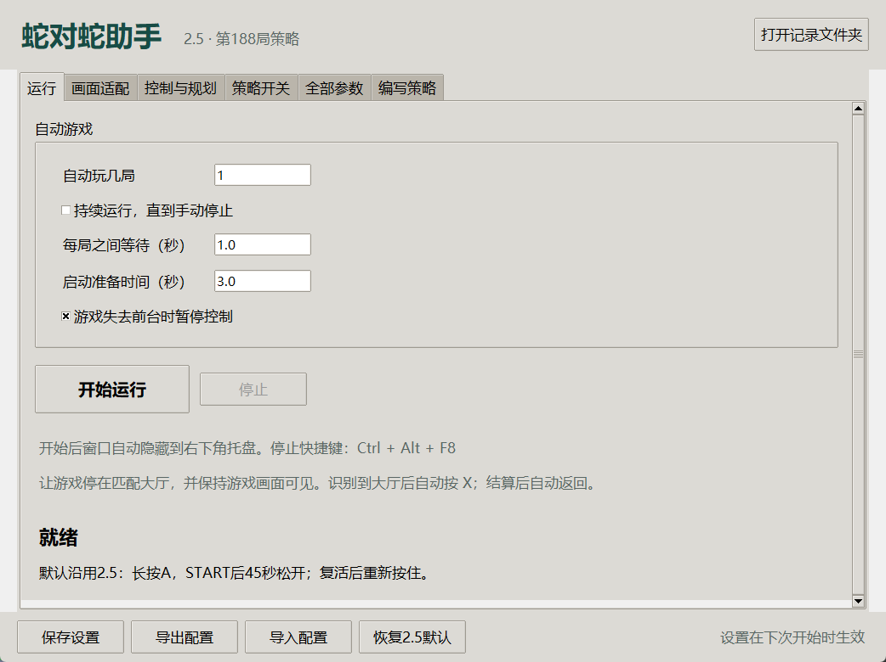
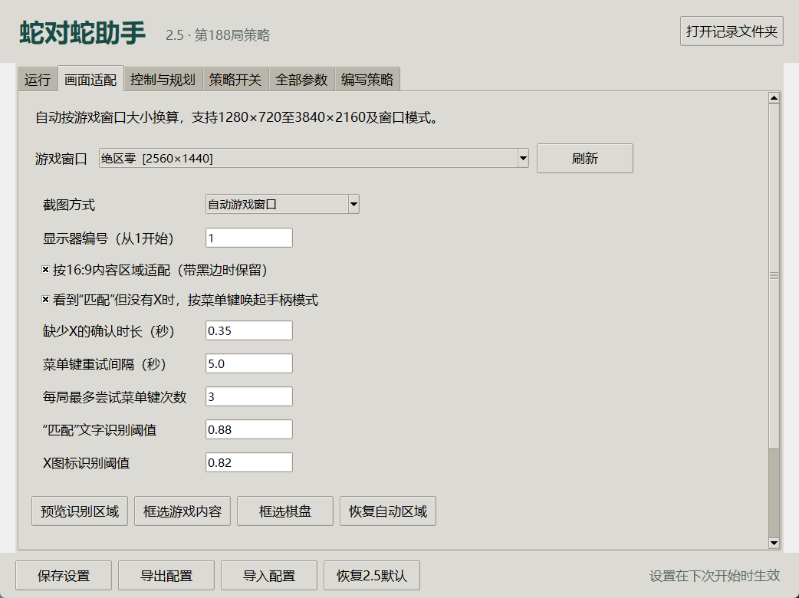

# ZZZ-SNAKE-DUEL-bot

**蛇对蛇助手 2.5** — 《绝区零》「蛇对蛇」自动游玩助手


> **软件版本** 1.0.2 ｜ **引擎基线** 2.5（第 188 局代码）｜ **作者** 101010 ｜ **平台** Windows 10 / 11 x64
>
> 仅供学习交流。请保留 exe 同级的 [《使用声明与免责声明.txt》](使用声明与免责声明.txt) 及随包签名材料，缺失或被修改会阻止运行。完整机制见 [《声明保护说明.md》](声明保护说明.md)。



## 目录

- [项目简介](#项目简介)
- [系统要求](#系统要求)
- [下载与安装](#下载与安装)
- [快速开始](#快速开始)
- [默认行为](#默认行为)
- [1K 到 4K 画面适配](#1k-到-4k-画面适配)
- [设置与保存](#设置与保存)
- [编写策略](#编写策略)
- [记录位置与排错](#记录位置与排错)
- [源码运行与重新打包](#源码运行与重新打包)
- [仓库结构](#仓库结构)
- [完整性校验](#完整性校验)
- [免责声明](#免责声明)
- [许可](#许可)
- [第三方组件](#第三方组件)
- [更新日志](#更新日志)

## 项目简介

蛇对蛇助手把 2.5 版原引擎（第 188 局代码）封装成可独立运行的 Windows 桌面程序：识别大厅与结算界面，通过 ViGEmBus 虚拟手柄完成匹配、游玩与返回，并提供画面适配、参数覆盖与自定义策略。

- **不改原引擎**：34 个实际运行模块与 5 个识别素材保持原文件哈希，桌面外壳只在加载时接入画面适配、参数与停止控制，不会修改原来的 2.5 目录。
- **独立运行**：exe 与 `_internal` 一起分发，目标机器不需要安装 Python，也不需要打开 VS Code。
- **分辨率自适应**：默认按游戏窗口客户区定位，1280×720 至 3840×2160 与窗口模式均可使用。
- **源码可查**：源码随包提供；启动与运行中都会校验声明签名与引擎哈希。

## 系统要求

| 项目 | 要求 |
| --- | --- |
| 操作系统 | Windows 10 / 11，64 位 |
| 虚拟手柄 | ViGEmBus 1.22.0，首次使用需安装并重启 |
| 运行权限 | 建议以管理员身份运行；1.0.2 已实机验证该方式下配置保存正常 |
| 游戏画面 | 需保持可见并正常渲染；最小化或被其他窗口遮住时不保证画面识别 |
| 源码环境 | Python 3.9 x64、Tkinter，以及 [源码/requirements.txt](源码/requirements.txt) 中的依赖 |

软件在后台运行，默认在游戏失去前台时暂停、释放手柄，切回游戏后继续。托盘图标可能被 Windows 收进“隐藏的图标”区域。

## 下载与安装

本仓库**只保存源码与文档**，可执行程序和驱动安装包在 [Releases](../../releases) 中提供。

1. 到 Releases 下载最新版本的完整压缩包，**完整解压**后运行。exe 与 `_internal` 文件夹必须保持在一起，不能只复制 exe。
2. 首次使用先安装 ViGEmBus 虚拟手柄驱动：可使用 Release 附件中的 `ViGEmBus_1.22.0_x64_x86_arm64.exe`，也可从[官方发布页](https://github.com/nefarius/ViGEmBus/releases/tag/v1.22.0)下载；按提示重启。具体步骤见 `驱动安装包/安装说明.txt`，来源与校验见 `驱动安装包/来源与校验.json`。软件不会自动或静默执行安装包。
3. 以管理员身份双击 `SnakeAssistant25.exe`。

## 快速开始

1. 打开绝区零的蛇对蛇，停在匹配大厅。
2. 在软件“画面适配”页选择游戏窗口，通常保持“自动游戏窗口”即可。
3. 在“运行”页填写自动游玩的局数；勾选“持续运行”可一直玩到手动停止。
4. 点击“开始运行”。主窗口隐藏到 Windows 右下角托盘，游戏回到前台；识别到大厅的 X/匹配提示后自动按 X，识别到 START 后开始控制红蛇。
5. 结算后自动按 A 返回大厅，再进行下一局。达到指定局数后停止，并重新显示软件窗口。

### 大厅没有 X 图标时（1.0.1 起）

若大厅仅显示“匹配”而没有 X 图标，连续确认约 0.35 秒后先按手柄**菜单键（Xbox START/Menu）**唤起手柄模式，X 出现后再按 X 匹配。

创建虚拟手柄后先等待约 0.7 秒；菜单键默认间隔 5 秒、每局最多 3 次，避免重复触发。可在“画面适配”页关闭或调整确认时间、重试间隔、次数和两个识别阈值。该流程同样适用于结算返回大厅时缺少 X 的情况。

### 停止

按 **Ctrl + Alt + F8**，或右键托盘图标选择“停止游戏控制”，或打开主窗口点击“停止”。正常停止会松开 A 并释放摇杆。

关闭正在运行的主窗口只会隐藏到托盘；要完全退出，请使用托盘菜单的“退出软件”。若停止后控制进程异常卡住，软件会在 8 秒后结束它。

## 默认行为

来源为 `version2/2.5`，即第 188 局代码。34 个实际运行模块与 5 个识别素材保持原文件哈希，桌面软件在加载时接入画面适配、参数与停止控制，不会修改原来的 2.5 目录。

| 设置 | 默认值 |
| --- | --- |
| 游戏中按键加速 | 持续按 A |
| 局末松开 A | 识别 START 后 45 秒，跨复活保持松开 |
| 复活加速重按 | 观察到复活动作后至少松开约 0.7 秒，之后重新长按 |
| 转向提前量初始值 | 170 毫秒，保留原算法的分模式校准 |
| 长蛇策略 | 长度超过 40 后经连续观测进入；长度持续低于 35 退出 |
| 长蛇局末保长 | START 后 45 秒开始 |
| 图像计算线程 / 截图线程 | 4 / 1 |
| 诊断画面保存 | 每隔 3 帧保存，可填 0 关闭 |

软件完成局数只在识别到结算并保存结算图后增加。等待超时、程序报错或主动停止不会被伪装成完成一局。界面显示的长度为识别估计，**成绩以结算图为准**。

## 1K 到 4K 画面适配

默认按游戏窗口的实际客户区定位，按 16:9 内容区域换算棋盘与右下角大厅提示，再统一到原算法的 928×800 画面。支持窗口移动、Windows 显示缩放和多屏，不用手动修改原代码的截图坐标。



- 1280×720、1920×1080、2560×1440、3840×2160 均有缩放样本验收；实体显示器的完整实机流程在 2560×1440 验证，4K 为缩放样本验证。
- 点“预览识别区域”，应看见完整 29×25 棋盘。程序会短暂隐藏主窗口，避免把软件本身截进棋盘。
- 若游戏显示了额外黑边，点“框选游戏内容”，在截图上拖出**完整游戏内容**；大厅提示也跟随这个区域缩放。
- 若棋盘位置或 HUD 比例不同，点“框选棋盘”，拖出完整棋盘，它会自动切到“手动棋盘区域”。手动区域按窗口比例保存，分辨率变化后仍会换算。
- “恢复自动区域”可清除两种手动框选。只调整棋盘区域并不会同时修正大厅提示；大厅错位时应先框选完整游戏内容。
- “整个显示器”是备用截图方式；显示器编号采用系统截图设备顺序，未必以主屏为 1。优先使用自动游戏窗口。

需要保持游戏自身 HUD 样式和棋盘布局与 2.5 录制版本一致；更换语言、HUD 大小或画面布局后应先预览，必要时校准。

## 设置与保存

所有设置在**下次点击开始**时载入，运行中编辑不会更改正在进行的局。软件会为每次运行保存一份配置快照。可使用底部“保存设置”“导出配置”“导入配置”“恢复 2.5 默认”。

### 常用设置

“控制与规划”页提供常用控制与长蛇参数。“策略开关”可以独立控制局末松 A、长蛇总策略、局末保长、窄口评分、敌蛇头交汇预测、逃生路线复用，以及主动追钻石/黄豆/加速道具。关闭主动追食仍可能沿途吃到食物。

### 全部参数

“全部参数”共整理 **6502 项**：294 个原配置常量，加上 34 个运行模块中的数值和布尔字面量。可按模块、函数、参数名、源码表达式搜索，双击按 JSON 类型填写；界面每次最多显示 600 项，请搜索缩小范围。

高级参数显示原始名称、类型、所在函数、原表达式和默认值。`true/false` 表示布尔值，字符串需要双引号，数组用方括号。仅修改过的项会写入覆盖配置，可单项恢复；“仅看已修改”便于核对。固定棋盘格数、几何规格和记录目录由软件管理，显示为只读。

### 优先级与风险

常用设置会先映射到对应的算法数值；若对**同一数值**另作高级覆盖，则以高级覆盖为准。因此恢复某个常用参数前，也应检查是否存在高级覆盖。未覆盖的数值按原 2.5 加载，不增加逐帧参数查询。

高级页包含底层数组索引、形状常量等数值，改动可能破坏算法；它们是供深入实验的入口，常用调整请优先使用“控制与规划”页。`NO_BOOST` 是原算法的规划架构选择，不能用它替代“按键加速方式”。

## 编写策略

详见 [《策略与参数说明.md》](策略与参数说明.md)。支持 JSON 条件规则和本地 Python 插件，在“编写策略”页编辑，然后在“策略开关”页启用。两种自定义功能默认均关闭。

## 记录位置与排错

### 记录位置

点击右上角“打开记录文件夹”。通常位于 `%LOCALAPPDATA%\SnakeAssistant25\records`，每次运行一个带时间的目录：

- `profile.json`：本次实际配置；启用插件时另存 `strategy_plugin.py`。
- `version.json`：软件版本、2.5 基线和引擎指纹。
- `status.json`、`console.log`：状态与运行记录。
- `logs/live_*.jsonl`：逐帧识别与控制记录；`logs/result_*.png`：结算截图；`logs/batch_*.json`：完成局数摘要。
- `frames_dump`：诊断画面。长时间运行时建议将保存间隔调大，或设为 0，以减少磁盘占用。

### 常见问题

- **换电脑后提示缺少依赖**：请使用完整的压缩包重新解压，不能只拷贝 exe。1.0.2 包内已修复 `_ctypes` DLL 报错，`ffi.dll`、Tcl/Tk 及 Python 运行时均随包提供。
- **不自动匹配**：检查游戏窗口选择、游戏是否前台，以及右下角“匹配”是否可见。预览会分别显示文字与 X 图标的识别结果，默认阈值分别为 0.88 和 0.82。只有文字和 X 均确认后才会按 X；只有文字时先尝试菜单键。未知界面不会猜测按键。
- **虚拟手柄创建失败**：检查 ViGEmBus 是否安装，关闭其他正在控制游戏的脚本后重试。软件不会在手柄失败时假装已经接管游戏。

## 源码运行与重新打包

### 源码运行

仓库附带 `源码` 目录。在 Python 3.9、64 位环境安装 [requirements.txt](源码/requirements.txt) 的依赖后，进入该目录运行：

```powershell
cd 源码
python -m venv .venv
.venv\Scripts\activate
pip install -r requirements.txt
python app.py
```

Tkinter 随常见 Windows Python 发行版提供；Conda 环境需要有 tk。`源码` 目录内的《使用声明与免责声明.txt》与 `app_assets/notice_manifest.*` 缺一不可，否则启动校验会失败。

### 重新打包

```powershell
cd 源码
python build.py
```

产物在 `dist/SnakeAssistant25`。从 1.0.2 开始，作者需通过 `SNAKE25_SIGNING_DIR` 指向另行保存的签名私钥目录，并在原 Windows 账户下构建；构建签名还需要 OpenSSL。

私钥不随便携软件包发布，不能仅凭软件包重新签署修改后的声明或资源。脚本会显式收集 Conda 中的 ffi/Tcl/Tk 库，以及动态加载引擎用到的依赖。构建方式参见 [PyInstaller 官方说明](https://www.pyinstaller.org/en/stable/usage.html)。

### 离线验收

```powershell
SnakeAssistant25.exe --self-test --self-test-output 检查报告.json
```

该入口只检查软件与虚拟控制器的替身，不开局，不创建真实游戏手柄。

## 仓库结构

```text
ZZZ-SNAKE-DUEL-bot/
├─ 源码/                     # Python 3.9 源码，可 python app.py 直接运行
│  ├─ app_*.py               # 桌面外壳：GUI、截图适配、设置、托盘、策略、测试
│  ├─ engine/                # 2.5 原引擎（34 个模块 + 5 个识别素材，哈希受保护）
│  ├─ app_assets/            # 图标素材、声明清单与签名
│  ├─ baseline.json          # 引擎模块 SHA-256 基线
│  ├─ parameter_catalog.json # 6502 项参数目录
│  ├─ app_notice_anchor.py   # 公开验证锚点（不含私有材料）
│  ├─ build.py               # 打包入口
│  ├─ release.py             # 生成交付目录与文件校验
│  ├─ sign_notice.py         # 作者签名步骤
│  └─ requirements.txt
├─ 第三方许可/               # 各依赖的许可原文
├─ 驱动安装包/               # 仅保留安装说明、来源与校验；exe 见 Releases
├─ docs/images/              # README 截图
├─ tools/verify_integrity.py # 哈希完整性校验脚本
├─ .github/workflows/        # ci.yml 校验；release.yml 由 tag 生成草稿 Release
├─ 使用说明.md
├─ 策略与参数说明.md
├─ 声明保护说明.md
├─ 使用声明与免责声明.txt
├─ 更新说明_1.0.1.md / 更新说明_1.0.2.md
├─ CHANGELOG.md
├─ LICENSE
└─ runtime_versions.json
```

以下内容**不入库**，只作为 Release 附件：`_internal/`（约 178 MB）、`SnakeAssistant25.exe`、`驱动安装包/*.exe`、`验收记录/`（含游戏画面与逐帧日志）、`文件校验.json`。

## 完整性校验

程序启动时会比对 [源码/baseline.json](源码/baseline.json) 与 [源码/app_assets/notice_manifest.json](源码/app_assets/notice_manifest.json)：

- 34 个引擎模块、5 个识别素材、参数目录与图标；
- 声明正文《使用声明与免责声明.txt》；
- 运行中每约 1.5 秒后台复查一次，异常时释放手柄并停止。

这些哈希按**原始字节**计算，任何换行转换都会导致校验失败，因此 [.gitattributes](.gitattributes) 对相关路径关闭了行尾规范化。提交或合并前可运行：

```powershell
python tools/verify_integrity.py
```

CI 会在 Windows 与 Linux 检出后各跑一次，确保跨平台克隆后字节仍然一致。

## 免责声明

- 本软件仅供**学习、研究与交流**，作者不对使用后果作任何担保；完整条款见 [《使用声明与免责声明.txt》](使用声明与免责声明.txt)。
- 自动化操作可能与游戏或平台的用户协议冲突，**存在账号被处罚的风险**，请自行判断是否使用。
- 请勿将本软件用于商业用途、代练代打或任何违反法律法规的场景。
- 声明签名只能提高删改门槛，不能保证绝对防破解，见 [《声明保护说明.md》](声明保护说明.md)。

## 许可

本仓库采用**非开源**的有限许可：允许个人学习与研究，允许在保留完整署名与声明的前提下非商业原样转载；禁止商业使用，禁止修改后以本软件名义分发。完整条款见 [LICENSE](LICENSE)。

`源码/engine/` 中如涉及第三方权利，归原权利人所有；本许可不改变任何第三方许可。

## 第三方组件

| 组件 | 用途 |
| --- | --- |
| Python 3.9 | 运行时（PSF License） |
| NumPy / OpenCV / Pillow | 图像与数值计算 |
| mss | 屏幕截图 |
| vgamepad + ViGEmBus | 虚拟 Xbox 手柄 |
| Tcl/Tk | 图形界面 |
| OpenSSL / zlib / bzip2 / xz / libffi / expat | 运行时依赖 |

各组件许可原文见 [第三方许可/](第三方许可)，驱动安装包来源与校验见 [驱动安装包/来源与校验.json](驱动安装包/来源与校验.json)。

## 更新日志

当前版本 1.0.2 的变更见 [CHANGELOG.md](CHANGELOG.md)。
